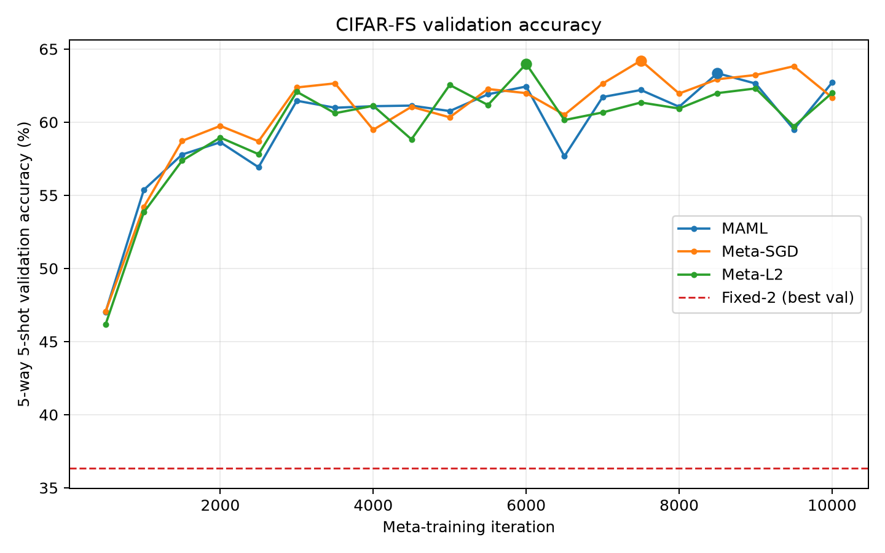
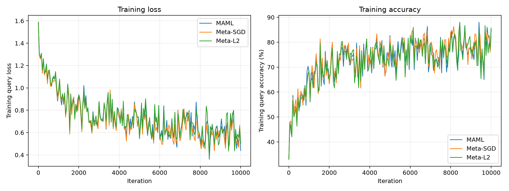
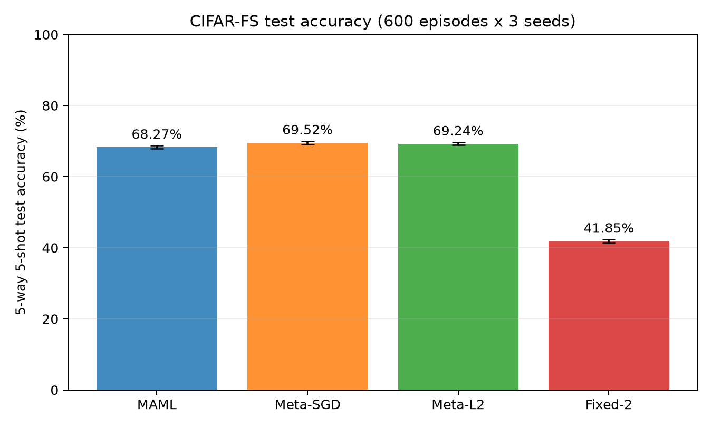
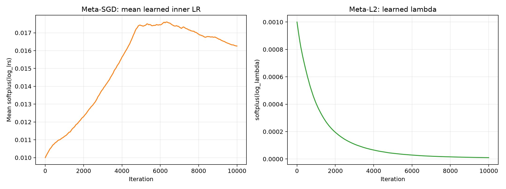
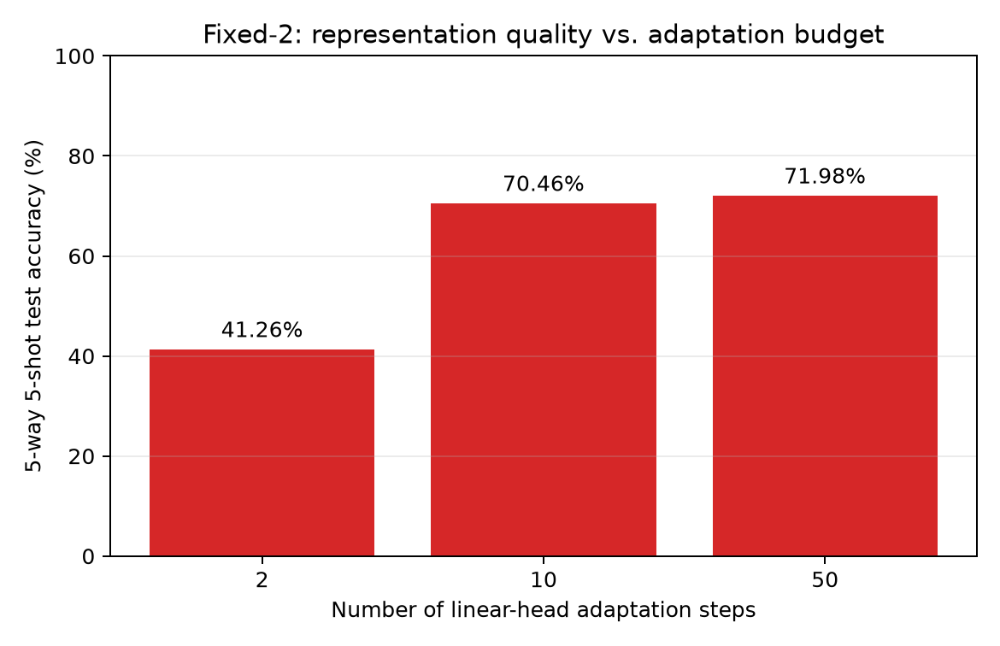

# CIFAR-FS 四种元学习对比：MAML / Meta-SGD / Meta-L2 / Fixed-2

本项目在 **CIFAR-FS** 上做 5-way 5-shot 的 few-shot 分类，对比四种方法：

- **MAML**：学习一个初始化，每个任务用固定内循环学习率走 5 步；
- **Meta-SGD**：学习初始化，同时为每个参数学一个内循环学习率；
- **Meta-L2**：MAML + 可学习的 L2 锚正则系数；
- **Fixed-2**：监督预训练一个冻结骨干，每个任务只训练一个新的 5 路线性头 2 步。

每个方法只训练 1 个随机种子；测试集用 **600 个 episode × 3 个 episode 种子** 评估。

---

## 0. 结论

| 方法 | 验证集最好 | 测试集（600×3） |
|---|---:|---:|
| MAML | 63.35% | **68.27% ± 0.43%** |
| Meta-SGD | 64.21% | **69.52% ± 0.47%** |
| Meta-L2 | 63.99% | **69.24% ± 0.38%** |
| Fixed-2（2 步） | 36.36% | **41.85% ± 0.56%** |

主要结论：

1. **Meta-SGD 在四个方法里测试准确率最高**，比 MAML 高约 1.25 个百分点。它学到的平均内循环学习率从 0.0100 升到约 0.0172，并且深层参数的学习率明显大于浅层。
2. **Meta-L2 与 MAML 基本持平**。可学习的 L2 系数从 0.001 下降到约 `2.86e-5`，说明外循环主动关掉了正则项，Meta-L2 实际退化成了 MAML。
3. **Fixed-2 的 2 步版本严重欠拟合**，只有 41.85%。同一个冻结骨干，线性头改成 10 步就到 **70.46%**，50 步到 **71.98%**。瓶颈是“只允许 2 步适配”，不是表征质量。
4. 由于只有 1 个训练种子，且 1,800 个测试 episode 的 95% 置信区间约 ±2.1 个百分点，**Meta-SGD / Meta-L2 / MAML 之间约 1 个百分点的差距不能当作显著差异**；Fixed-2 的差距则非常明显。

---

## 1. CIFAR-FS 是什么

CIFAR-FS 是 CIFAR-100 的 few-shot 分类基准，由 Bertinetto 等人（ICLR 2019）提出。它把 CIFAR-100 的 100 个细类划分成三个**类别互不重叠**的 split：

| split | 类别数 | 每类图片 | 总图片 | 用途 |
|---|---:|---:|---:|---|
| train | 64 | 600 | 38,400 | 元训练，采样训练任务 |
| val | 16 | 600 | 9,600 | 选择验证集最好的 checkpoint |
| test | 20 | 600 | 12,000 | 最终测试 |

图像是 **32×32 RGB**。

> 数据文件里的标签是 split 内局部标签，所以文件夹名是 `class_000`、`class_001` 这种形式，不代表原始 CIFAR 语义类别。episode 分类只使用相对标签，不影响训练和评估。

### 1.1 一个 episode 是什么

训练不是“把 64 个类当成一个 64 路分类任务”，而是每次采样一个 **5-way 5-shot** 小任务：

1. 从当前 split 随机抽 **5 个类**；
2. 每个类抽 **5 张 support**，共 25 张；
3. 每个类再抽 **15 张 query**，共 75 张；
4. 模型只用 support 做内循环适配；
5. 在 query 上计算损失或准确率。

同一个 episode 的 support 和 query 类别相同，但图片不同；不同 episode 的 5 个类可以完全不同。

### 1.2 训练和测试协议

每个 meta-iteration：

```text
采样 4 个 episode（meta_batch_size = 4）
对每个 episode：
    θ' = θ
    用 25 张 support 做 5 步内循环
    在 75 张 query 上算 L_query(θ')
把 4 个 episode 的 query loss 平均后反传
用 Adam 更新外循环参数
```

训练配置：

- 10,000 个 meta-iteration；
- 每个 iteration 4 个 episode；
- 共采样 **40,000 个训练 episode**；
- 内循环 5 步；
- MAML / Meta-SGD / Meta-L2 使用二阶梯度；
- 测试集用 600 个 episode，报告平均 query 准确率。

### 1.3 和普通分类的区别

普通分类训练一个固定的 64 路分类器；CIFAR-FS 训练的是：

> 如何用 25 张 support，快速构造一个 5 路分类器。

因此：

- 没有跨 episode 固定的分类头；
- 每个 episode 的 5 个类都可能不同；
- 验证/测试的 16/20 个类在元训练时完全没见过；
- 评价的是“新任务上的快速适应能力”，不是“64 个训练类的拟合能力”。

---

## 2. 实验设置

| 项目 | 值 |
|---|---|
| 数据集 | CIFAR-FS |
| 任务 | 5-way 5-shot，15 query/class |
| 输入 | 32×32 RGB |
| 模型 | Conv4，4 个 conv/GroupNorm/ReLU/pool 块，64 通道 |
| 参数量 | 114,117（5 路分类头） |
| 内循环步数 | 5（Fixed-2 为 2） |
| 外循环 | Adam，meta_lr = 1e-3 |
| meta_batch_size | 4 |
| meta-iterations | 10,000 |
| 测试 | 600 episode × 3 个 episode 种子 |
| 硬件 | 8 GB NVIDIA RTX 5060 Laptop GPU |

数据增强：

- 训练 episode：`RandomCrop(32, padding=4)` + `RandomHorizontalFlip`；
- 验证/测试 episode：`CenterCrop(32)`；
- 使用 CIFAR 的 mean/std 归一化。

---

## 3. 四个算法的具体实现

四个方法共用 `metalab/data.py` 的 episode 采样器、`metalab/models.py` 的 Conv4、`metalab/engine.py` 的训练循环。核心差异在 `metalab/algorithms.py`。

### 3.1 MAML

```text
θ'₀ = θ
θ'_{t+1} = θ'ₜ − α · ∇_{θ'ₜ} L_support(θ'ₜ)
meta_loss = L_query(θ'_K)
```

- `α` 是固定标量，`inner_lr: 0.01`；
- 内循环 5 步；
- `first_order: false`，即保留二阶图；
- 所有参数都参与内循环适配；
- 外循环 Adam，`meta_lr: 0.001`。

MAML 的局限是所有参数、所有层共用一个内循环学习率。

### 3.2 Meta-SGD

```text
θ'_{t+1} = θ'ₜ − α_i ⊙ ∇_{θ'ₜ} L_support(θ'ₜ)
```

- `α_i` 与每个参数同形状，是逐参数、逐元素的学习率；
- 用 `softplus(log_lrs)` 保证为正，并 `clamp(max=0.5)`；
- `log_lrs` 用单独的 `hyper_lr: 0.001` 更新；
- 初始 `α = 0.01`，训练结束平均约 **0.01716**。

从 checkpoint 读取的逐层平均学习率：

| 参数组 | 平均内循环学习率 |
|---|---:|
| `features.0.conv.weight`（第 1 层） | 0.0060 |
| `features.1.conv.weight`（第 2 层） | 0.0115 |
| `features.2.conv.weight`（第 3 层） | 0.0142 |
| `features.3.conv.weight`（第 4 层） | 0.0262 |
| `features.3.norm.weight`（最后一层 GN） | 0.0679 |
| `classifier.weight` | 0.0180 |
| `classifier.bias` | 0.0029 |

解释：浅层（边缘/颜色）保持较小的步长，深层（语义特征）用更大的步长快速适配；分类器偏置几乎不动。这就是 Meta-SGD 比 MAML 更灵活的原因。

### 3.3 Meta-L2

内循环损失：

```text
L_inner = CE(support; θ') + (λ/2) · Σ_i ||θ'_i − θ_i||²
```

- `λ = softplus(log_lambda)`；
- 初始 `λ = 0.001`；
- `learn_l2_lambda: true`，所以 `λ` 也由外循环学习；
- 内循环仍是 5 步，`α = 0.01`。

训练结果：`λ` 从 0.001 单调下降到约 **2.86e-5**，约 35 倍下降。外循环发现“少正则”在训练集上更好，因此 Meta-L2 几乎退化成了 MAML。

### 3.4 Fixed-2

Fixed-2 不是 episodic 元训练，而是“固定表征 + 2 步线性头适配”的基线。

**第一阶段：监督预训练**

- 在 64 个训练类上做普通 64 路分类；
- 40 个 epoch；
- AdamW，`lr = 1e-3`，`weight_decay = 5e-4`；
- batch size 128；
- 预训练后，64 路分类头在训练集上的准确率约 **64.07%**。

**第二阶段：每个 episode 的 2 步适配**

1. 丢弃 64 路分类头；
2. 新建一个 5 路线性头；
3. 冻结 Conv4 骨干；
4. 只用 25 张 support，对线性头做 **2 步 SGD**，`lr = 0.05`；
5. 在 75 张 query 上评估。

没有外循环，没有 meta-loss；训练由 `engine.py` 的 `train_fixed2()` 单独完成。

---

## 4. 结果

### 4.1 主结果

| 方法 | 验证集最好 | 最好验证轮次 | 最后验证集 | 测试集（600×3） | 测试 loss | Support acc | 训练时间 |
|---|---:|---:|---:|---:|---:|---:|---:|
| MAML | 63.35% | 8500 | 62.71% | **68.27% ± 0.43%** | 0.839 | 95.51% | 59.7 min |
| Meta-SGD | 64.21% | 7500 | 61.69% | **69.52% ± 0.47%** | 0.792 | 97.56% | 70.7 min |
| Meta-L2 | 63.99% | 6000 | 62.00% | **69.24% ± 0.38%** | 0.816 | 96.59% | 77.1 min |
| Fixed-2（2 步） | 36.36% | — | 36.36% | **41.85% ± 0.56%** | 1.784 | 58.97% | 未写入 CSV |

测试集的三个种子结果：

| 方法 | seed 0 | seed 1 | seed 2 |
|---|---:|---:|---:|
| MAML | 68.13% | 67.92% | 68.76% |
| Meta-SGD | 69.33% | 69.18% | 70.05% |
| Meta-L2 | 69.37% | 68.81% | 69.53% |
| Fixed-2（2 步） | 41.26% | 41.93% | 42.36% |

### 4.2 曲线

验证集准确率：



训练 query loss / accuracy：



测试集柱状图：



学到的内循环学习率与 L2 系数：



### 4.3 Fixed-2 的适配步数消融

对同一个 `pretrain.pt`，只改变线性头适配步数：

| 线性头适配步数 | 测试准确率 | Support acc |
|---:|---:|---:|
| 2 | 41.85% | 58.97% |
| 10 | **70.46%** | 98.91% |
| 50 | **71.98%** | 100.00% |



这个消融说明：**2 步不是“固定表征”的真实上限，而是严重欠拟合**。同一个骨干，10 步就超过 MAML，50 步达到 71.98%。

---

## 5. 结果分析

### 5.1 为什么 Meta-SGD 最好

Meta-SGD 的收益来自“让不同层用不同的内循环步长”：

- 第 1 层平均学习率只有 0.0060，避免破坏通用边缘/颜色特征；
- 第 4 层平均学习率 0.0262，最后一层 GroupNorm 到 0.0679，让高层语义特征快速适配新任务；
- 分类器权重 0.0180，分类器偏置 0.0029。

这比 MAML 的单一 `α=0.01` 更灵活。代价是：

- checkpoint 从约 1.39 MB 增加到约 2.76 MB；
- 训练时间从 59.7 分钟增加到 70.7 分钟，约 +18%；
- 多了一份 `log_lrs` 外循环超参数。

### 5.2 为什么 Meta-L2 没有明显收益

Meta-L2 的 `λ` 从 0.001 降到 `2.86e-5`，说明外循环主动关掉了 L2 正则。可能原因：

- 5 步内循环本身已经起到了“早停/约束”的作用；
- 25 张 support 太少，L2 锚约束会阻碍 support 拟合；
- 标量 `λ` 自由度太低，无法做到“某些层正则、某些层不放”。

因此，Meta-L2 在这个设置下不是一个有竞争力的新方法，更接近“带一个会自己消失的正则项的 MAML”。

如果要继续做，可以尝试：

- 固定 `λ` 而不是学习它；
- 逐层 `λ`；
- 给 `λ` 加下界或不同的参数化；
- 在 1-shot 或更大 support 上重试。

### 5.3 Fixed-2 的结论要改写

如果只看 2 步结果，会得到“固定表征很差（41.85%）”的结论；但 10 步/50 步消融说明：

- 冻结的 Conv4 表征其实很强；
- 2 步线性头只完成 58.97% 的 support 准确率，远未收敛；
- “Fixed-2”这个名字会让人误以为它是“固定表征 + 少量适配”的强基线，实际它是一个**适配预算极小的弱基线**。

如果这篇工作要提交 PR/论文，建议：

1. 保留 2 步结果，但明确标注“2-step adaptation, intentionally small budget”；
2. 同时报告 10 步/50 步的 linear probe 结果，作为“固定表征上限”的参考；
3. 或者把基线改名为 `Fixed-2step`，避免和常见的 “fixed feature + linear probe” 混淆。

### 5.4 验证集与测试集的关系

三个元学习方法都出现“测试集高于验证集”：

- MAML：val 63.35 → test 68.27；
- Meta-SGD：val 64.21 → test 69.52；
- Meta-L2：val 63.99 → test 69.24。

可能原因：

- 验证集只用了 100 个 episode，测试集用了 1,800 个 episode，采样方差更小；
- 验证集和测试集的 16/20 个类难度不同；
- 验证集用于选择 `best.pt`，但测试集类别分布略有差异。

因此不要用验证集和测试集的绝对差值下结论；最终比较只看测试集，并且要报告多种子/多 episode 的方差。

### 5.5 训练后期是否过拟合

三个元学习方法的验证集曲线在 6,000–8,000 轮之后基本平台化，并伴随 ±1–2 个百分点的波动：

- MAML 最好在 8500；
- Meta-SGD 最好在 7500，最后 10000 轮反而降到 61.69%；
- Meta-L2 最好在 6000，最后 62.00%。

说明：

- `best.pt` 的早停是必要的；
- 恒定学习率 0.001 在后期偏大，换成 cosine schedule 可能更稳；
- 不要用 `last.pt` 直接报告结果。

### 5.6 统计显著性

每个方法测试了 1,800 个 episode（3×600）。按 p≈0.69 估算，95% 置信区间约 **±2.1 个百分点**。因此：

- Meta-SGD 比 MAML 高 1.25 个百分点，**在统计上没有强证据**；
- Meta-L2 比 MAML 高 0.97 个百分点，**也不能认为显著**；
- Meta-SGD 与 Meta-L2 差 0.28 个百分点，基本等价；
- Fixed-2 与三者差 26–28 个百分点，差距是明确的。

要做更严格的结论，至少需要 **3 个独立训练种子**（不同参数初始化/数据顺序），报告均值 ± 标准差，而不是只换测试 episode 种子。

---

## 6. 局限

1. **只有一个训练种子**；表中的 ± 只是测试 episode 的采样标准差，不是训练方差。
2. 只做了 **5-way 5-shot**；没有 1-shot、10-shot、不同 way 数。
3. 只做了 CIFAR-FS；没有跨数据集验证。
4. 使用 GroupNorm 而不是 MAML 原论文的 BatchNorm，绝对数值不能直接和论文表格对齐。
5. Fixed-2 的 10/50 步消融只评估了测试集，没有重新做验证集选模型；但同一个 `pretrain.pt` 下结论仍然成立。
6. Meta-L2 只尝试了标量 `λ`，没有逐层或固定 `λ` 的对照。

---

## 7. 文件说明

```text
cifarfs_meta_comparison/
├── README.md
├── requirements.txt
├── .gitignore
├── configs/
│   ├── cifarfs_maml.yaml
│   ├── cifarfs_metasgd.yaml
│   ├── cifarfs_metal2.yaml
│   └── cifarfs_fixed2.yaml
├── metalab/
│   ├── __init__.py
│   ├── config.py
│   ├── data.py
│   ├── models.py
│   ├── algorithms.py
│   ├── engine.py
│   └── utils.py
├── scripts/
│   ├── download_data.py
│   ├── train.py
│   └── evaluate.py
└── reports/
    ├── cifarfs_results.csv
    ├── cifarfs_results.json
    ├── cifarfs_fixed2_ablation.csv
    ├── figures/
    │   ├── cifarfs_val_curves.png
    │   ├── cifarfs_train_curves.png
    │   ├── cifarfs_test_bar.png
    │   ├── cifarfs_hyperparameters.png
    │   └── cifarfs_fixed2_steps.png
    └── metrics/
        ├── cifarfs_maml_test.json
        ├── cifarfs_maml_test_seed1.json
        ├── cifarfs_maml_test_seed2.json
        ├── cifarfs_metasgd_test.json
        ├── cifarfs_metasgd_test_seed1.json
        ├── cifarfs_metasgd_test_seed2.json
        ├── cifarfs_metal2_test.json
        ├── cifarfs_metal2_test_seed1.json
        ├── cifarfs_metal2_test_seed2.json
        ├── cifarfs_fixed2_test.json
        ├── cifarfs_fixed2_test_seed1.json
        ├── cifarfs_fixed2_test_seed2.json
        ├── cifarfs_fixed2_steps10_test.json
        └── cifarfs_fixed2_steps50_test.json
```

### 根目录

| 文件 | 作用 |
|---|---|
| `README.md` | 本文：CIFAR-FS 含义、实验设置、四个算法、结果与分析 |
| `requirements.txt` | 运行代码所需的 Python 包 |
| `.gitignore` | 忽略数据、checkpoint、缓存等大文件 |

### `configs/`

| 文件 | 作用 |
|---|---|
| `cifarfs_maml.yaml` | MAML：5-way 5-shot，5 步内循环，二阶 |
| `cifarfs_metasgd.yaml` | Meta-SGD：逐参数内循环学习率 |
| `cifarfs_metal2.yaml` | Meta-L2：可学习 L2 锚系数 |
| `cifarfs_fixed2.yaml` | Fixed-2：64 路预训练 + 2 步线性头适配 |

### `metalab/`

| 文件 | 作用 |
|---|---|
| `__init__.py` | 包说明和版本 |
| `config.py` | YAML 读取、`--set` 覆盖、配置保存 |
| `data.py` | CIFAR-FS 文件夹扫描、5-way 5-shot episode 采样、图像变换 |
| `models.py` | Conv4 骨干和 `reset_classifier()` |
| `algorithms.py` | MAML、Meta-SGD、Meta-L2、Fixed-2 的内循环/外循环实现 |
| `engine.py` | 训练循环、验证/测试、Fixed-2 预训练、checkpoint |
| `utils.py` | 随机种子、设备选择、日志、计时 |

### `scripts/`

| 文件 | 作用 |
|---|---|
| `download_data.py` | 下载 CIFAR-FS parquet，转成 `data/cifar-fs/{train,val,test}/class_*` |
| `train.py` | 读配置并训练某一个方法 |
| `evaluate.py` | 加载 `best.pt` 或 `pretrain.pt`，在 test 上跑 N 个 episode |

### `reports/`

| 文件 | 作用 |
|---|---|
| `cifarfs_results.csv` | 四个方法的汇总表：验证集、测试均值/标准差、loss、support acc、时间、超参数 |
| `cifarfs_results.json` | 同上，含每个测试种子的原始准确率；适合程序读取 |
| `cifarfs_fixed2_ablation.csv` | Fixed-2 在 2/10/50 步适配下的结果 |
| `figures/cifarfs_val_curves.png` | 三个元学习方法的验证集曲线，Fixed-2 为水平线 |
| `figures/cifarfs_train_curves.png` | 训练 query loss 和 accuracy 曲线 |
| `figures/cifarfs_test_bar.png` | 四个方法的测试准确率柱状图（带标准差） |
| `figures/cifarfs_hyperparameters.png` | Meta-SGD 的平均学习率、Meta-L2 的 `λ` 随训练变化 |
| `figures/cifarfs_fixed2_steps.png` | Fixed-2 的 2/10/50 步消融图 |
| `metrics/cifarfs_*_test.json` | 每个方法、每个测试种子的原始评估指标 |
| `metrics/cifarfs_fixed2_steps*_test.json` | Fixed-2 10/50 步消融的原始评估指标 |

---

## 8. 数据与引用

数据来源：

- CIFAR-FS 由 CIFAR-100 派生；
- 类别划分来自 Bertinetto 等人的 CIFAR-FS split；
- 本项目使用的 parquet 镜像来自 `GATE-engine/cifarfs`，与 `learn2learn` 的 CIFARFS 数据一致。

论文：

- Finn, Abbeel, Levine. *Model-Agnostic Meta-Learning for Fast Adaptation of Deep Networks.* ICML 2017.
- Li et al. *Meta-SGD: Learning to Learn Quickly for Few-Shot Learning.* arXiv:1707.09835.
- Bertinetto et al. *Meta-learning with differentiable closed-form solvers.* ICLR 2019.（CIFAR-FS）
